<!-- Clickable portfolio banner. Upload your image to assets/banner.webp for it to display. -->
<div align="center">
  <a href="https://vivek1566.github.io/MyPortfolio/" target="_blank" rel="noopener noreferrer">
    
  </a>
</div>

<br/>

<div align="center">
  <a href="https://vivek1566.github.io/MyPortfolio/">
    
  </a>
</div>

<div align="center">
  <a href="https://vivek1566.github.io/MyPortfolio/" target="_blank" rel="noopener noreferrer">
    
  </a>
  <a href="https://www.linkedin.com/in/vivek-rajak-11b387204" target="_blank" rel="noopener noreferrer">
    
  </a>
  <a href="mailto:vivekrajak3004@gmail.com">
    
  </a>
  
</div>

<br/>

```yaml
name: Vivek Rajak
role: AI/ML Builder · Full-Stack Developer
education: B.Tech CSE @ Lovely Professional University
portfolio: https://vivek1566.github.io/MyPortfolio/
focus:
  - Computer Vision
  - RAG & LLM Pipelines
  - Scalable APIs
  - Full-Stack Web Apps
interests:
  - Applied AI Systems
  - Backend Architecture
  - Cloud & DevOps
  - Hackathons
mantra: "Build with purpose. Learn with discipline. Level up daily."
```

## 💡 What I Do

- **Applied AI & Computer Vision:** Build detection and classification pipelines with YOLO11, PyTorch, OpenCV, XGBoost, and Transformers.
- **LLM & RAG Engineering:** Create semantic search and retrieval systems with Gemini API, FAISS, and Sentence-Transformers, served through fast, testable APIs.
- **Full-Stack Product Engineering:** Build REST backends with FastAPI, Flask, Node.js, and Redis, paired with responsive React, Vite, and Tailwind CSS dashboards.

## ⚙️ My Workflow

```text
[ Problem Framing ] ──▶ [ Data & Model Design ] ──▶ [ FastAPI / Node Backend ] ──▶ [ React UI & Deployment ]
   Requirements,            YOLO / PyTorch /             REST APIs, Auth,              Interactive Dashboards,
   Metrics & SLA            RAG & Evaluation             Docker & Testing              Exports & Monitoring
```

## 🛠️ Tech Arsenal

**AI / ML & Computer Vision**  
YOLO11 · PyTorch · OpenCV · XGBoost · Transformers · Gemini API · FAISS · Sentence-Transformers

**Languages**  
Python · C++ · JavaScript · SQL

**Backend, Frontend & Databases**  
FastAPI · Flask · Node.js · React · Vite · Tailwind CSS · Redis · REST APIs

**Tools & Platforms**  
Git · GitHub · Docker · Linux · Cloud & DevOps

## 🚀 Featured Projects

Explore my latest projects and demos on my [portfolio](https://vivek1566.github.io/MyPortfolio/) and [GitHub repositories](https://github.com/Vivek1566?tab=repositories).

## 📚 Currently Learning & Highlights

- **Currently exploring:** Advanced Backend Engineering, System Design, and Production MLOps
- **Certifications:** NPTEL Cloud Computing · AI-Driven MERN & DevOps Bootcamp (Grade A) · NASSCOM Generative AI · Infosys DBMS & C++
- **Recognition:** Top 25 / 200 in Code Quest (Optimyzr for Success) · Led WNS Cares CyberSmart Drive (40+ participants)

## 📊 GitHub Stats

<div align="center">
  
  
</div>

## 🐍 Contribution Snake

<div align="center">
  <picture>
    <source media="(prefers-color-scheme: dark)" srcset="https://raw.githubusercontent.com/Vivek1566/Vivek1566/output/github-contribution-grid-snake-dark.svg" />
    <source media="(prefers-color-scheme: light)" srcset="https://raw.githubusercontent.com/Vivek1566/Vivek1566/output/github-contribution-grid-snake.svg" />
    
  </picture>
</div>

## 🤝 Let's Connect

- 🌐 [Portfolio](https://vivek1566.github.io/MyPortfolio/)
- 💼 [LinkedIn](https://www.linkedin.com/in/vivek-rajak-11b387204)
- ✉️ [Email](mailto:vivekrajak3004@gmail.com)
